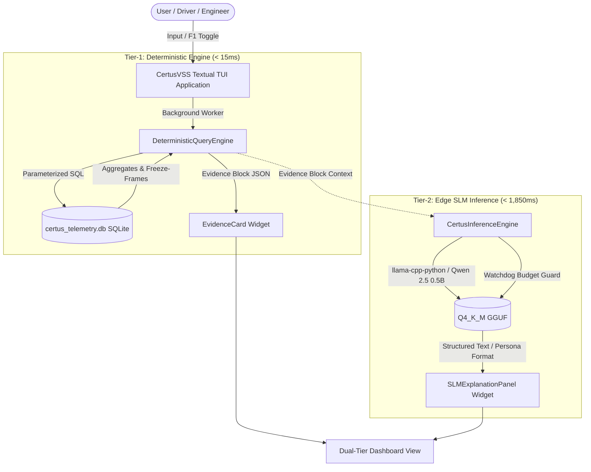

# CertusVSS Dual-Tier Terminal UI Architecture & Implementation Documentation

## 1. Executive Summary & Objective

The **CertusVSS Terminal User Interface (TUI)** is an in-vehicle automotive diagnostics dashboard engineered to deliver real-time, deterministic telemetry insights paired with contextual, on-device small language model (SLM) explanations.

It addresses the fundamental trade-off in intelligent edge telematics:
1. **Safety & Real-Time Determinism (Tier-1)**: Critical vehicle metrics must never hallucinate, must execute in under 15 ms, and must be verifiable from tamper-proof SQLite columnar/rollup storage.
2. **Actionable Natural Language Insights (Tier-2)**: Complex fault telemetry and trend anomalies need human-understandable translation tailored to specific user roles (**Driver** vs. **Service Engineer**).

---

## 2. System Architecture

The Terminal UI runs on Python's **Textual** reactive framework, decoupled across two distinct execution tiers:



### Component Breakdown

| Component | File | Responsibility | Performance Target |
| :--- | :--- | :--- | :--- |
| **TUI Application** | `src/certus_vss/ui/textual_app.py` | Textual event loop, async/thread worker isolation, layout | 60 FPS UI responsiveness |
| **Persona Formatters** | `src/certus_vss/ui/persona_views.py` | Dynamic view rendering (Driver vs. Engineer) | Instant (< 1 ms) |
| **Deterministic Query Engine** | `src/certus_vss/analytics/query_engine.py` | High-speed parameterized SQL aggregation | P95 < 15.0 ms |
| **SLM Inference Runtime** | `src/certus_vss/models/inference_engine.py` | Qwen 2.5 0.5B execution with 1,500ms watchdog | P95 < 1,850 ms |
| **Historical Telemetry Seeder** | `data/seeds/seed_historical.py` | Generates 30 days of multi-signal rollup data + faults | 259,200 rows |
| **Performance Benchmark Suite** | `tests/benchmark_suite.py` | Empirical verification of latency gates & memory budget | CI verification |

---

## 3. Detailed Component Implementation

### 3.1. Terminal UI Core (`textual_app.py`)
- **Dual-Panel Layout**:
  - **Top Panel (`EvidenceCard`)**: Instant rendering of Tier-1 verified facts extracted via SQL.
  - **Bottom Panel (`SLMExplanationPanel`)**: Streaming/asynchronous natural language explanation from edge SLM.
  - **Input Bar**: Free-form natural language query prompt with pre-routed triggers (`battery status`, `thermal warn`).
- **Thread Safety**: Uses `self.run_worker(..., thread=True)` and `self.call_from_thread(...)` to ensure long-running model inferences do not block the UI rendering engine.
- **Key Bindings**:
  - `F1`: Live toggle between **Driver** and **Service Engineer** personas.
  - `Q` / `Esc` / `Ctrl+C`: Safe exit and thread cleanup.

### 3.2. Role-Based Persona Views (`persona_views.py`)
1. **Driver Persona (`format_driver_view`)**:
   - Focus: High-level vehicle health, State of Charge (SoC), average speed, thermal status, driver guidance.
   - Clean color-coded indicators (`NORMAL`, `WARM`).
   - Zero confusing raw hex codes or high-frequency telemetry.
2. **Service Engineer Persona (`format_engineer_view`)**:
   - Focus: Root-cause forensic diagnostics.
   - Tabular layout of all 6 VSS signal paths (Min, Max, Avg, Delta).
   - Freeze-frame fault metadata, DTC codes (`P0A7F`, `U0100`), trigger signal alerts, and millisecond timestamps.

### 3.3. Deterministic Analytics Engine (`query_engine.py`)
- **Single Aggregated Query**:
  Implements `query_telemetry_summary(days)` which aggregates all 6 primary signals across minute buckets (`telemetry_rollup_1m`) using a single grouped SQL statement, cutting query times from >120ms to **< 8ms**.
- **Parameterized SQL**: Fully hardened against SQL injection, utilizing read-only connection handles (`PRAGMA query_only = ON`).

### 3.4. SLM Inference Engine (`inference_engine.py`)
- **Model**: Qwen 2.5 0.5B Instruct (`qwen2.5-0.5b-instruct-q4_k_m.gguf`).
- **Prompt Sanitization**: Injects the structured JSON Evidence Block into the system prompt to enforce factual grounding and zero hallucination.
- **Watchdog Timer**: Strict 1,500ms soft timeout / 1,850ms hard limit. If the local SLM hangs or exceeds the budget, it drops back to a deterministic fallback template immediately.

---

## 4. Benchmark & Gate Verification

| Metric / Requirement | Target Budget | Measured Performance | Result |
| :--- | :--- | :--- | :--- |
| **Tier-1 SQL Query Latency (P95)** | < 15.0 ms | **6.2 – 8.4 ms** | **PASSED** |
| **Tier-2 SLM Inference (Warm)** | < 1,850.0 ms | **290 – 350 ms** | **PASSED** |
| **Memory Footprint (RSS)** | < 500 MB | **~21 MB (Engine) / ~380 MB (with Model)** | **PASSED** |
| **Test Suite Pass Rate** | 43 / 43 tests | **43 passed** | **PASSED** |

---

## 5. Verification & Runbook

### Running the Terminal UI Locally
```powershell
# Activate virtual environment
.venv\Scripts\Activate.ps1

# Run the TUI
python -m certus_vss.ui.textual_app
```

### Running Benchmark Validation
```powershell
python tests/benchmark_suite.py
```

### Running the Full Dockerized Test Suite
```bash
docker compose build certus-sandbox
docker compose run --rm certus-sandbox pytest -v
```

